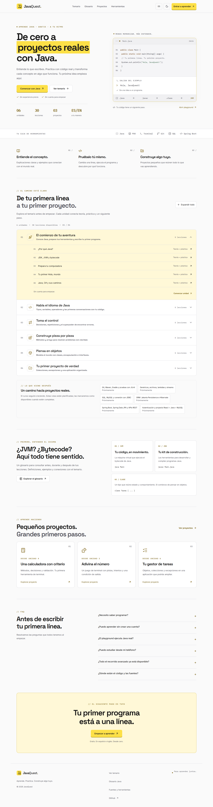
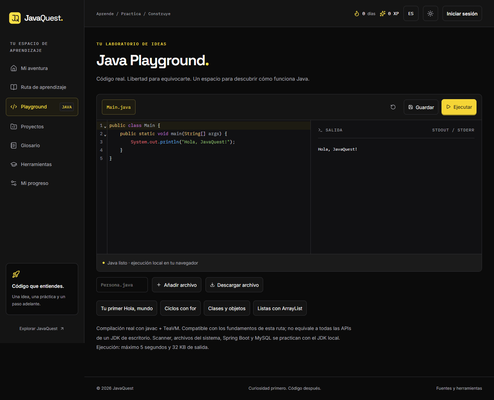

# JavaQuest ☕

**Aprende Java, un paso a la vez.** Una plataforma educativa gratuita para aprender con tu clase, experimentar con código real y construir tus primeros proyectos.

[](https://github.com/DEIMER-PY/javaquest/actions/workflows/ci.yml)

**Despliegue preparado:** https://javaquest-gamma.vercel.app — actualmente protegido por Vercel Authentication. La apertura a la clase está pendiente de aprobación del ajuste SSO; las cuentas Supabase están pendientes de configuración gratuita.

[English documentation](docs/README.en.md) · [Diseño y referencias](docs/design-system.md) · [Arquitectura](docs/architecture.md) · [Instalación](docs/setup.md) · [Ruta educativa](docs/curriculum.md) · [Verificación](docs/verification.md)


## Qué incluye

- 30 lecciones completas en español e inglés: historia, JVM, herramientas, tipos, control de flujo, métodos, arrays, objetos y colecciones.
- Portada pública con temario desplegable y un glosario bilingüe de treinta conceptos, búsqueda por categoría y enlaces a las lecciones.
- Playground propio con javac y TeaVM en WebAssembly: ejecuta Java en tu navegador, sin API de pago.
- Tres proyectos locales guiados: calculadora, adivina el número y gestor de tareas.
- Evaluaciones, progreso, XP, logros y sesiones diarias. Las cuentas se sincronizan mediante Supabase cuando está configurado.
- Diseño responsive, tema claro/oscuro, navegación con teclado y movimiento reducido.
- Identidad negro/amarillo inspirada en JSCamp, monograma JQ y fuentes gratuitas autoalojadas. El modo oscuro es inicial y se conserva la preferencia del visitante.
- Ruta de ampliación hacia pruebas, SQL, JDBC, Hibernate, Spring Boot y un proyecto frontend + API + MySQL.

Los módulos futuros se muestran como **próximamente**. No se presentan como cursos terminados.

## Ejecutar localmente

Necesitas Node.js 22 o superior y Git. No necesitas Java para ejecutar la aplicación web.

```bash
git clone https://github.com/DEIMER-PY/javaquest.git
cd javaquest
npm ci
npm run java:prepare
npm run dev
```

Abre http://localhost:3000. Para las cuentas, copia `.env.example` a `.env.local` y sigue [la configuración de Supabase](docs/setup.md). Sin credenciales, las lecciones y el playground funcionan y la interfaz identifica el progreso como local.

La portada está en `/es` o `/en`, el panel en `/es/dashboard` y el glosario en `/es/glossary`. Puedes consultar el contenido y practicar antes de crear una cuenta.

```bash
npm run typecheck
npm run lint
npm test
node scripts/verify-java.mjs
npm run build
npm start
```

Para pruebas de navegador, inicia la app y ejecuta `npm run test:e2e`. La configuración local usa Chrome instalado; en CI se instala Chromium.

La auditoría visual recorre 288 combinaciones de pantalla, idioma y tema. Para actualizar las capturas reales de ambos temas ejecuta `node scripts/capture-design.mjs`; `BASE_URL` permite apuntar a otro puerto local.



## Límites del playground

El compilador real cubre los fundamentos de la ruta; no implementa todas las APIs de un JDK de escritorio. **Scanner no está disponible.** Los proyectos interactivos de terminal, Spring Boot y MySQL se ejecutan localmente con un JDK, siguiendo instrucciones del curso. La ejecución tiene límite de 5 segundos y 32 KB de salida, y la compilación puede tardar en dispositivos modestos.



## Costo y publicación

El proyecto está diseñado para planes gratuitos: Vercel Hobby, Supabase Free y subdominio del proveedor. No tiene pagos ni suscripciones para alumnos. Las cuotas de los proveedores siguen aplicando: el presupuesto cero no equivale a capacidad ilimitada. No uses planes de prueba que cambien automáticamente a pago.

La organización Supabase detectada durante la preparación ya tenía dos proyectos activos. La sincronización requiere escoger capacidad gratuita disponible y configurar Google/GitHub OAuth. Consulta [el estado de verificación](docs/verification.md) antes de compartirlo como plataforma con cuentas habilitadas.

## Estructura

```text
src/app/          Rutas, API y callback OAuth
src/components/  Interfaz, editor y componentes shadcn/ui
src/lib/         Currículo, progreso, evaluación y clientes Supabase
content/es/      Lecciones MDX en español
content/en/      Lecciones MDX en inglés
public/          SVG originales y puente aislado del playground
scripts/         Preparación y comprobación del compilador
supabase/        Esquema y migraciones con RLS
tests/           Pruebas de progreso, contenido y navegador
docs/            Guías, diagramas, capturas y decisiones
```

## Contribuir y licencias

Lee [CONTRIBUTING.md](CONTRIBUTING.md). Usa Conventional Commits con emoji después del prefijo: `feat(editor): ✨ ...`, `fix(auth): 🐛 ...`, `docs: 📝 ...`.

Código MIT · contenido propio CC BY 4.0 · [atribuciones de terceros](THIRD_PARTY_NOTICES.md).

Creado por **Deimer Jose Caro Silvera** para aprender y compartir con su clase.
