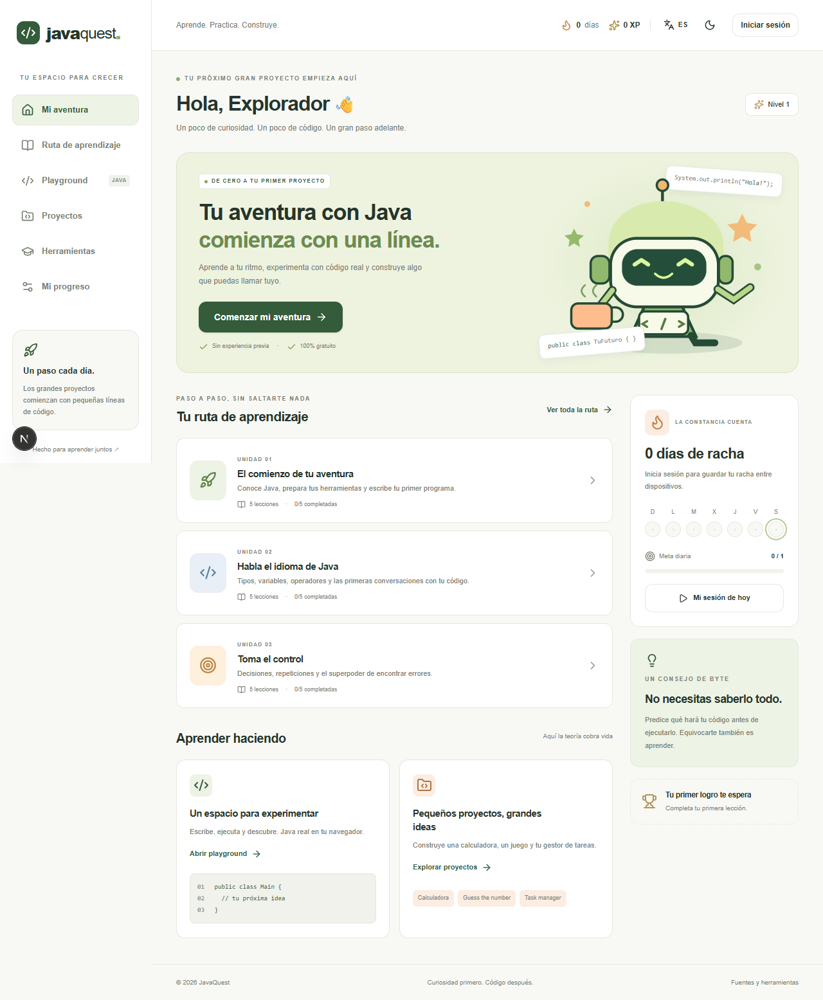

# JavaQuest

A free bilingual Java learning platform, designed for a classroom and a developer portfolio.



## Features

Thirty Spanish/English lessons cover history, JVM, installation, types, flow control, methods, arrays, objects, collections, and exceptions. A custom javac + TeaVM playground compiles real Java in the browser. Three guided local projects provide a calculator, guessing game, and task manager.

Supabase supports Google/GitHub accounts, private progress, daily activity, project steps, and drafts when configured. Without it, lessons and playground remain available and guest progress is explicitly browser-local. Future SQL, ORM, Spring Boot, and full-stack paths are marked as upcoming.

## Development

```bash
git clone https://github.com/DEIMER-PY/javaquest.git
cd javaquest
npm ci
npm run java:prepare
npm run dev
```

Use Node.js 22+. Visit http://localhost:3000/en. Copy `.env.example` to `.env.local` and follow [setup](setup.md) to enable accounts. Never commit credentials.

```bash
npm run typecheck
npm run lint
npm test
node scripts/verify-java.mjs
npm run build
```

Browser tests use an installed Chrome locally and Chromium in CI. Start the app before `npm run test:e2e`.

## Runtime boundaries

The browser compiler is not a complete desktop JDK. Scanner is unsupported. Terminal projects, system files, Spring Boot, and MySQL run with a local JDK. Execution is interruptible and limited to five seconds and 32 KB output. Compiler resources are SHA-256 pinned and loaded only when needed.

Free hosting remains subject to provider quotas. Read [verification status](verification.md) for external integrations still requiring configuration. No paid service is automatically enabled.

See [architecture](architecture.md), [curriculum](curriculum.md), and [contributing](../CONTRIBUTING.md). Original code is MIT; original educational content is CC BY 4.0. Third-party licenses are preserved.
