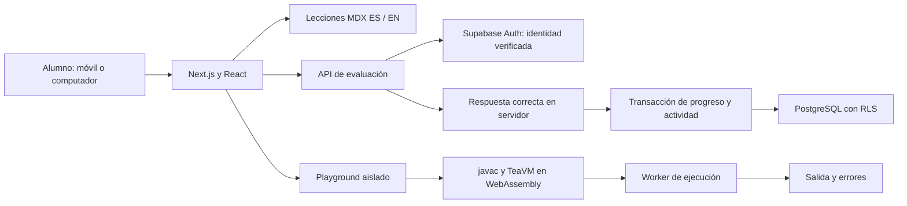
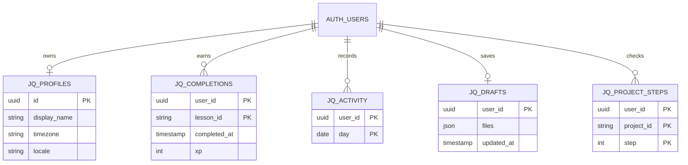

# Arquitectura y decisiones

## Flujo de aprendizaje

La compilación no se realiza en una función de Vercel. Cada navegador aporta su capacidad de cómputo. El primer arranque descarga aproximadamente 7 MB; las páginas educativas no cargan el editor.

El esquema también conserva intentos de evaluación. Una transacción serializada por usuario limita a 200 evaluaciones por 24 horas para proteger las cuotas gratuitas; una respuesta incorrecta no otorga XP ni actividad diaria.

## Aislamiento del playground

La página crea un iframe con `sandbox="allow-scripts"`, sin `allow-same-origin`. El iframe tiene un origen opaco y una política CSP que solo permite leer recursos públicos del compilador y su puente. El programa generado se ejecuta en un worker desechable. No recibe cookies, objetos de sesión ni variables privadas.

El canal de comunicación es un `MessagePort` transferido, no un listener global que acepta resultados arbitrarios. Compilación y ejecución usan workers separados. Detener termina ambos. El límite de tiempo de ejecución es 5 segundos; el de compilación, 60 segundos; la inicialización tiene 90 segundos. La salida se limita a 32 KB. Esto no proporciona una cuota dura de memoria: un programa puede agotar recursos de su propia pestaña; debe indicarse en usos avanzados.

## Modelo de datos

Las claves compuestas hacen idempotentes las finalizaciones y la actividad diaria. Los clientes autenticados solo leen sus completaciones y actividad; las escrituras de XP provienen del servidor después de validar la respuesta. `jq_record_completion` usa derechos del invocador y permisos exclusivos de `service_role`: registra ambos datos en una transacción.

El cliente puede modificar su perfil, borrador y pasos de proyecto con políticas de propiedad. Ningún perfil es público. La clave privada de Supabase solo existe en el servidor. Las claves publicables funcionan junto con RLS, no sustituyen sus políticas.

## Decisiones

- Next.js permite un frontend y API en un solo proyecto TypeScript.
- Supabase usa PostgreSQL para la plataforma; MySQL se enseña como herramienta del ecosistema Java.
- MDX está versionado, con identificadores estables entre idiomas. Solo se compila contenido del repositorio, nunca MDX enviado por estudiantes.
- Las rutas avanzadas se incorporan por módulos terminados. No se simulan lecciones, usuarios, rachas ni videos.
- Las evaluaciones del playground son práctica personal; el código del navegador no sirve como prueba de una calificación oficial.
- No se usan APIs de IA, ejecutores de pago ni almacenamiento de videos propios.
